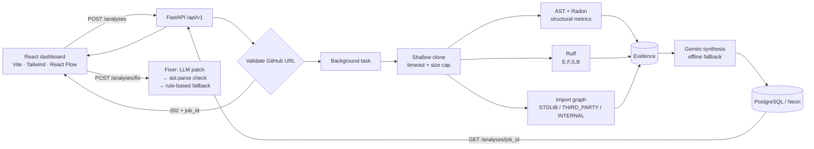

# 🔍 AI Code Review + Repository Analyst

Paste a public GitHub repository URL and get an automated code-health report: **static-analysis findings** (Ruff incl. security rules, Python `ast`, Radon complexity), a **classified import dependency graph** (stdlib / third-party / internal), and an **AI-written executive review** (Google Gemini, with an offline fallback). A React dashboard shows the results, scan history, and one-click **AI fix suggestions whose patches are syntax-verified before they are shown**.

> **Design idea:** the LLM never reviews raw code on its own. Deterministic analyzers produce the evidence first (file, line, rule, metrics) and the LLM only summarises and prioritises it, which keeps the review grounded. For fixes, any patch the LLM proposes must pass a deterministic `ast.parse` check; otherwise a rule-based fallback is returned.

---

## 📑 Contents
[Features](#-features) · [Architecture](#-architecture) · [Tech Stack](#-tech-stack) · [Project Structure](#-project-structure) · [Getting Started](#-getting-started) · [Docker](#-docker) · [Configuration](#%EF%B8%8F-configuration) · [API Reference](#-api-reference) · [Analysis Details](#-analysis-details) · [Testing & CI](#-testing--ci) · [Benchmark](#-benchmark--evaluation) · [Security](#-security--safety) · [Project Status](#-project-status) · [Roadmap](#-roadmap) · [Author](#-author)

---

## ✨ Features

| Feature | Details |
|---|---|
| **Safe repo ingestion** | Only `https://github.com/<owner>/<repo>` URLs are accepted (regex-validated). Cloned with `git clone --depth 1 --single-branch --branch <branch>`, falling back to the default branch if the requested one doesn't exist. Enforces a clone timeout and a repository-size cap (`MAX_REPO_SIZE_MB`); the temp clone is always deleted afterwards. |
| **Ruff + security rules** | Runs `ruff check --select E,F,S,B` (pycodestyle errors, Pyflakes, Bandit-style security, bugbear). Rule codes map to severity: `S*` → HIGH, `E*` → MEDIUM, others → LOW. |
| **AST & complexity analysis** | Python `ast` visitors flag bare `except:` and `eval`/`exec`; Radon reports per-function cyclomatic complexity (> 10 flagged, > 15 HIGH). All findings (Ruff + AST + Radon) are merged into one list. |
| **Classified dependency graph** | Every `import` / `from … import` becomes an edge, de-duplicated and labelled `STDLIB`, `THIRD_PARTY` or `INTERNAL`; capped at 60 edges and rendered interactively with React Flow. |
| **AI review synthesis** | Gemini turns metrics + merged findings into a concise executive summary. If no API key is set (or the call fails), an offline summary is generated, so the app always works. |
| **Verified AI fixes** | `POST /analyses/fix` asks Gemini for a JSON `{explanation, suggested_patch}`, then validates the patch with `ast.parse`. Invalid patches are discarded in favour of rule-based fallbacks (e.g. `except:` → `except Exception as exc:`). |
| **Asynchronous scan jobs** | Scans run as background tasks. `POST /analyses` returns `202` immediately; progress is tracked per job (`PENDING → RUNNING`, stages `QUEUED → CLONING_REPOSITORY → STATIC_AND_AST_ANALYSIS → COMPLETED / FAILED`) and failures store an `error_message`. |
| **Persistent scan history** | Every scan is stored in PostgreSQL (`analysis_jobs`); the history drawer lists the latest 20 and reopens any past report. |
| **Health probes** | `/health`, `/api/v1/health` and `/api/v1/health/ready` (checks DB connectivity). |
| **Benchmark & evaluation** | `scripts/benchmark_engine.py` measures pipeline throughput on a real repository and checks that every fix patch returned by the API is syntactically valid. |
| **Tests, Docker, CI** | `pytest` suite, `Dockerfile` + `docker-compose.yml`, a GitHub Actions workflow (PostgreSQL 16 service + Ruff + pytest) and a `ruff.toml` lint config. |

---

## 🏗 Architecture



**Request flow:** `POST /analyses` validates the URL, stores a `PENDING` job and returns **`202 Accepted`** with a `job_id`. A FastAPI background task then runs: clone → AST/Radon → Ruff → dependency extraction → AI summary → save results → delete the clone, updating `status` / `current_stage` as it goes. Clients poll `GET /analyses/{job_id}` until the job is `COMPLETED` (or `FAILED`).

---

## 🧰 Tech Stack

| Layer | Technology |
|---|---|
| Backend | Python 3.12, FastAPI, Uvicorn, Pydantic v2, pydantic-settings |
| Database | PostgreSQL (Neon), SQLAlchemy 2.0 (async), asyncpg |
| Analysis | Ruff, Radon, Python `ast` |
| AI | Google Gemini (`gemini-1.5-flash` by default) + offline fallback |
| Frontend | React 19, Vite, Tailwind CSS 4, `@xyflow/react`, lucide-react |
| DevOps | Docker, docker-compose, GitHub Actions, pytest, Alembic (configured), Ruff config |

---

## 📁 Project Structure

```
AI-code-review/
├── app/
│   ├── main.py                     # FastAPI app, CORS, startup (creates/updates tables)
│   ├── core/config.py              # Settings from .env
│   ├── api/v1/routes/
│   │   ├── analyses.py             # Background scan job + POST/GET /analyses, POST /analyses/fix
│   │   └── health.py               # /health, /health/ready
│   ├── services/
│   │   ├── repository_ingestion.py # URL validation, shallow clone, size cap, cleanup
│   │   ├── static_analysis.py      # Ruff runner + severity mapping
│   │   ├── python_ast_analyzer.py  # AST rules + Radon complexity
│   │   ├── dependency_analyzer.py  # Import edges + STDLIB/THIRD_PARTY/INTERNAL tagging
│   │   ├── fixer.py                # LLM fix suggestions + AST syntax verification
│   │   ├── file_classifier.py      # Python-file discovery helpers
│   │   └── orchestrator.py         # Job-based staged pipeline (not used by /analyses yet)
│   ├── ai/                         # Gemini client/provider, mock provider, prompts
│   ├── models/                     # AnalysisJob, StaticAnalysisFinding, DependencyEdge
│   ├── schemas/                    # Pydantic schemas
│   └── db/                         # Async engine/session, declarative base
├── frontend/                       # React dashboard (src/App.jsx, DependencyGraph.jsx)
├── alembic/ · alembic.ini          # Alembic setup (baseline revision is empty for now)
├── tests/                          # pytest: analyzers + API routes
├── scripts/benchmark_engine.py     # Throughput benchmark + fix-patch validity evaluation
├── .github/workflows/ci.yml        # GitHub Actions: Ruff + pytest
├── Dockerfile · docker-compose.yml
├── pytest.ini · ruff.toml · requirements.txt · .env.example
└── storage/                        # Temporary clones (git-ignored)
```

---

## 🚀 Getting Started

### Prerequisites
- Python **3.11+** (3.12 recommended) and **Git** on your `PATH`
- Node.js 18+
- A PostgreSQL database (a free [Neon](https://neon.tech) project works)
- *(Optional)* a [Google AI Studio](https://aistudio.google.com/) API key

### Backend
```bash
git clone https://github.com/ShashankSingh2020/AI-code-review.git
cd AI-code-review

python -m venv venv
source venv/bin/activate            # Windows: venv\Scripts\activate
pip install -r requirements.txt

cp .env.example .env                # fill in DATABASE_URL (and optionally the Gemini key)
uvicorn app.main:app --reload
```
API: http://127.0.0.1:8000 · Swagger UI: http://127.0.0.1:8000/docs. Tables are created (and missing columns added) on startup.

### Frontend
```bash
cd frontend
npm install
npm run dev                         # http://localhost:5173
```
The dashboard calls `http://127.0.0.1:8000/api/v1` (set in `frontend/src/App.jsx`). CORS allows `localhost:5173` / `127.0.0.1:5173`.

---

## 🐳 Docker

The compose file runs the **backend API** and reads your `.env` (so `DATABASE_URL` should point to your hosted PostgreSQL, e.g. Neon).

```bash
cp .env.example .env                # fill in DATABASE_URL
docker compose up --build           # API on http://localhost:8000
```
The image is based on `python:3.12-slim` with `git` installed (needed for cloning). Run the frontend separately with `npm run dev`.

---

## ⚙️ Configuration

Copy `.env.example` → `.env`. **Never commit `.env`** (it's in `.gitignore`).

| Variable | Default | Description |
|---|---|---|
| `DATABASE_URL` | *(required)* | `postgresql+asyncpg://<user>:<password>@<host>/<db>?ssl=require` |
| `APP_ENV` / `APP_DEBUG` | `development` / `true` | Environment name; `APP_DEBUG` enables SQL echo. |
| `API_V1_STR` | `/api/v1` | API prefix. |
| `PROJECT_NAME` | `AI Code Review + GitHub Repository Analyst` | API title. |
| `MAX_REPO_SIZE_MB` | `50` | Repositories larger than this are rejected after cloning. |
| `PIPELINE_TIMEOUT_SECONDS` | `300` | Timeout applied to `git clone`. |
| `MAX_REPO_FILES`, `MAX_SINGLE_FILE_BYTES`, `CLONE_TIMEOUT_SECONDS` | `500`, `512000`, `45` | Reserved for the job-based `orchestrator.py`; not used by the `/analyses` endpoint yet. |
| `TEMP_STORAGE_PATH` | `./storage/temp_repos` | Temporary storage directory. |
| `LLM_PROVIDER` | `mock` | `mock` or `gemini`. |
| `GEMINI_API_KEY` | – | Enables real Gemini reviews and fixes. |
| `GEMINI_MODEL` | `gemini-1.5-flash` | Gemini model name. |

---

## 📡 API Reference

Base URL: `http://127.0.0.1:8000/api/v1` · interactive docs at `/docs`.

| Method | Endpoint | Description |
|---|---|---|
| `GET` | `/health` | Liveness (also available at `/api/v1/health`). |
| `GET` | `/health/ready` | Readiness (DB check). |
| `POST` | `/analyses` | Queue an analysis (returns `202`). Body: `{"repo_url": "https://github.com/owner/repo", "branch_name": "main"}` |
| `GET` | `/analyses` | Latest 20 scans (summary rows). |
| `GET` | `/analyses/{job_id}` | Job status and, once `COMPLETED`, the full report (`404` if unknown). |
| `POST` | `/analyses/fix` | Syntax-verified AI explanation + patch for one finding. |

```bash
# 1) queue a scan  →  202 Accepted
curl -X POST http://127.0.0.1:8000/api/v1/analyses \
  -H "Content-Type: application/json" \
  -d '{"repo_url": "https://github.com/pallets/click.git", "branch_name": "main"}'
# {"job_id": "job_1a2b3c4d", "status": "PENDING", "message": "Scan job queued successfully.", ...}

# 2) poll until status is COMPLETED (or FAILED)
curl http://127.0.0.1:8000/api/v1/analyses/job_1a2b3c4d
```

Invalid URLs (non-GitHub, non-HTTPS) return `400`. While a job runs, `status` is `PENDING` / `RUNNING` and `current_stage` shows the active step; the report fields are filled in once it is `COMPLETED`. `findings` is one merged list (Ruff + AST + Radon). Example completed report (shape; counts from a local run on `pallets/click`):

```json
{
  "job_id": "job_1a2b3c4d",
  "repo_url": "https://github.com/pallets/click.git",
  "branch_name": "main",
  "status": "COMPLETED",
  "current_stage": "COMPLETED",
  "error_message": null,
  "structural_metrics": { "file_count": 91, "function_count": 1305, "class_count": 121, "complexity_avg": 2.93 },
  "findings": [
    { "rule_id": "S110", "severity": "HIGH", "file_path": "src/click/core.py",
      "line": 42, "title": "…", "message": "…" }
  ],
  "dependencies": [
    { "source_node": "core", "target_node": "typing.Optional", "category": "STDLIB",
      "edge_type": "import_from", "line_number": 2 }
  ],
  "ai_summary": "…",
  "created_at": "…",
  "completed_at": "…"
}
```

Fix request / response:
```json
// POST /analyses/fix
{ "rule_id": "AST-E001", "message": "Bare except", "file_path": "core/processor.py", "line": 42,
  "code_context": "try:\n    x()\nexcept:\n    pass" }
// → { "rule_id": "AST-E001", "file_path": "core/processor.py", "line": 42,
//     "explanation": "…", "suggested_patch": "try:\n    x()\nexcept Exception as exc:\n    pass" }
```

---

## 🔬 Analysis Details

- **Ruff**: deterministic lint and security checks; JSON output is normalised to `{rule_id, severity, file_path, line, title, message}`.
- **AST scanner**: works on the parsed syntax tree (not raw text), so comments and strings never cause false positives. Flags `except:` (`AST-E001`) and `eval`/`exec` (`AST-S001`).
- **Radon**: cyclomatic complexity per function/method (`RADON-CC`); also yields function/class counts and average complexity.
- **Dependency graph**: edges are tagged using `sys.stdlib_module_names` (stdlib), the set of module names found in the repo (internal), and everything else (third-party).
- **Evidence-grounded AI**: the prompt contains only computed metrics and sample findings. Without a key (or on API failure) a rule-based summary is returned.
- **Verified fixes**: LLM patches must parse as valid Python (`ast.parse`) before being returned.

---

## 🧪 Testing & CI

```bash
pip install -r requirements.txt
python -m pytest -v
```

The suite covers the AST/dependency analyzers (on a generated sample repo) and the API (health, invalid-URL `400`, unknown-job `404`, fix fallback). **Route tests import the app, so `DATABASE_URL` must be set** (e.g. in `.env`) and point to a reachable database.

`.github/workflows/ci.yml` runs on every push/PR to `main` against a **PostgreSQL 16 service container**: install dependencies → `ruff check app/` (rules in `ruff.toml`) → `pytest`. Route tests need the database tables to exist, so create them (e.g. by running the app lifespan with `with TestClient(app) as client:`) before querying jobs.

---

## 📈 Benchmark & Evaluation

```bash
PYTHONPATH=. python scripts/benchmark_engine.py     # Windows (PowerShell): $env:PYTHONPATH="."; python scripts/benchmark_engine.py
```
`DATABASE_URL` must be set (it is read by the app settings), and the script clones `pallets/click` from GitHub.

**1 · Pipeline throughput** on `pallets/click` (91 Python files, 1,305 functions, 1,561 findings). Measured in a Linux container across two runs; your numbers will vary with hardware and network:

| Stage | Time |
|---|---|
| Clone + ingestion | ~0.5–0.6 s |
| AST + Radon | ~0.8–1.0 s |
| Ruff (`E,F,S,B`) | ~0.2–0.5 s |
| Dependency graph | ~0.4 s |
| **Total analysis** | **~1.3–1.9 s (≈ 48–70 files/s)** |

**2 · Fix-patch validity** runs 5 representative findings (`AST-E001`, `AST-S001`, `E722`, `B007`, `S102`) through the fixer and checks each returned patch with `ast.parse`: **5 / 5 valid**.

> ℹ️ This second check verifies the *safety gate*: patches that don't parse are never returned (a rule-based fallback is used instead), so a 100 % pass rate is expected by design. It does **not** measure whether a patch is semantically correct or how often the LLM's raw output is valid. Without `GEMINI_API_KEY` the evaluation exercises the rule-based fallbacks only.

---

## 🛡 Security & Safety

- Repository code is **only parsed, never executed or imported**.
- Strict URL allow-list: HTTPS GitHub repositories only; the branch is passed as a separate argument (no shell execution).
- Shallow, single-branch clone with a timeout and a repo-size cap; temporary clone removed after every run.
- LLM output is never trusted blindly: fix patches are syntax-verified.
- Secrets come from environment variables; `.env` is git-ignored and `.env.example` contains placeholders only.
- CORS restricted to the local Vite dev origins.

---

## 📌 Project Status

**Tested end-to-end** (API + PostgreSQL 16, run locally against `pallets/click`: 91 files, 1,305 functions, 121 classes, ~1,500 findings): `POST /analyses` → `202`, then polling `GET /analyses/{job_id}` until `COMPLETED`.

- ✅ URL validation, branch-aware shallow clone with timeout + size cap
- ✅ Ruff (`E,F,S,B`) + AST + Radon findings merged into one list
- ✅ Dependency graph with `STDLIB` / `THIRD_PARTY` / `INTERNAL` classification
- ✅ Background jobs with status/stage tracking and failure capture; reports persisted and served by `GET /analyses` and `GET /analyses/{job_id}`
- ✅ AST-verified fix suggestions with rule-based fallbacks
- ✅ Health probes, React dashboard, pytest suite
- ✅ Reproducible benchmark script (see [Benchmark](#-benchmark--evaluation))

**Known limitations**
- Python repositories only.
- Jobs use FastAPI `BackgroundTasks` (in-process): there is no durable queue, retry or concurrency limit, and a queued/running job is lost if the server restarts.
- "Internal" classification matches module *file names*, so it is an approximation for large projects with duplicate names.
- The dependency graph shows at most 60 unique edges.
- Schema changes are still applied at startup (`create_all` + PostgreSQL-specific `ALTER TABLE … IF NOT EXISTS`); Alembic is configured, but its initial revision is an empty baseline.
- The React dashboard does not poll for job completion yet (it reads the first `POST` response), so completed reports currently appear via the history drawer / `GET /analyses/{job_id}`.
- Two Gemini SDKs are listed in `requirements.txt` (`google-generativeai`, `google-genai`).
- `orchestrator.py` (job-based pipeline) is not wired into the API yet.

---

## 🗺 Roadmap

- [ ] Dashboard polling with live stage updates
- [ ] Durable job queue (Celery / RQ / ARQ) with retries and concurrency limits
- [ ] Real Alembic migrations instead of startup `create_all` / `ALTER TABLE`
- [ ] Unify on a single Gemini SDK
- [ ] Larger test coverage (ingestion, Ruff service, DB persistence) and a coverage badge
- [ ] Evaluate real LLM patches (semantic correctness, not just syntax) on a labelled set of findings
- [ ] Containerise the frontend and add it to docker-compose
- [ ] Live deployment
- [ ] JavaScript/TypeScript analysis support

---

## 👤 Author

**Shashank Pratap Singh** — [GitHub](https://github.com/ShashankSingh2020) · [LinkedIn](https://linkedin.com/in/shashank-pratap-singh-530437303) · singh2020shashank@gmail.com
