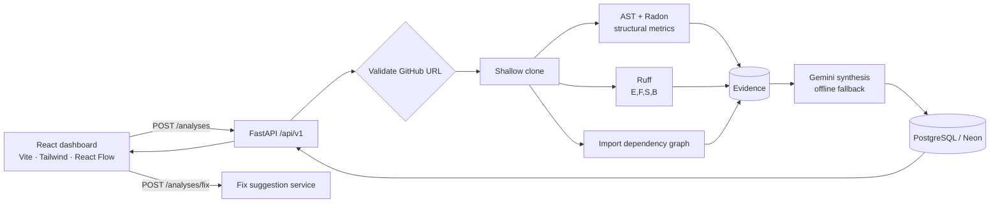

# 🔍 AI Code Review + Repository Analyst

Paste a public GitHub repository URL and get an automated code-health report: **static-analysis findings** (Ruff incl. security rules), **structural metrics** (Python `ast` + Radon complexity), an **import dependency graph**, and an **AI-written executive review** (Google Gemini, with an offline fallback). A React dashboard shows the results, scan history, and one-click AI fix suggestions.

> **Design idea:** the LLM never reviews raw code on its own. Deterministic analyzers produce the evidence first (file, line, rule, metrics) and the LLM only summarises and prioritises it, which keeps the review grounded and limits hallucination.

---

## 📑 Contents
[Features](#-features) · [Architecture](#-architecture) · [Tech Stack](#-tech-stack) · [Project Structure](#-project-structure) · [Getting Started](#-getting-started) · [Configuration](#%EF%B8%8F-configuration) · [API Reference](#-api-reference) · [Analysis Details](#-analysis-details) · [Security](#-security--safety) · [Project Status](#-project-status) · [Roadmap](#-roadmap) · [Author](#-author)

---

## ✨ Features

| Feature | Details |
|---|---|
| **Safe repo ingestion** | Only `https://github.com/<owner>/<repo>` URLs are accepted (regex-validated). Cloned with `git clone --depth 1 --single-branch --branch <branch>`, falling back to the default branch if the requested one doesn't exist. Enforces a clone timeout and a repository-size cap (`MAX_REPO_SIZE_MB`); the temp clone is deleted in a `finally` block. |
| **Ruff + security rules** | Runs `ruff check --select E,F,S,B` (pycodestyle errors, Pyflakes, Bandit-style security, bugbear). Rule codes map to severity: `S*` → HIGH, `E*` → MEDIUM, others → LOW. |
| **AST & complexity analysis** | Python `ast` visitors flag bare `except:` and `eval`/`exec`; Radon reports per-function cyclomatic complexity (> 10 flagged, > 15 HIGH). |
| **Dependency graph** | `import` / `from … import` edges per module (capped at 50 edges for a readable graph), rendered interactively with React Flow. |
| **AI review synthesis** | Gemini turns metrics + merged findings into a concise executive summary. If no API key is set (or the call fails) an offline summary is generated, so the app always works. |
| **AI fix suggestions** | Click any finding for a short explanation and a suggested patch (`POST /analyses/fix`), also with an offline fallback. |
| **Persistent scan history** | Every scan is stored in PostgreSQL (`analysis_jobs`); the history drawer lists the latest 20 and reopens any past report. |
| **Health probes** | `/health` and `/health/ready` (checks DB connectivity). |

---

## 🏗 Architecture



**Request flow:** validate URL → clone → structural analysis → Ruff → dependency extraction → AI summary → persist → return report → delete clone.

---

## 🧰 Tech Stack

| Layer | Technology |
|---|---|
| Backend | Python, FastAPI, Uvicorn, Pydantic v2, pydantic-settings |
| Database | PostgreSQL (Neon), SQLAlchemy 2.0 (async), asyncpg |
| Analysis | Ruff, Radon, Python `ast` |
| AI | Google Gemini (`gemini-1.5-flash` by default) + offline fallback |
| Frontend | React 19, Vite, Tailwind CSS 4, `@xyflow/react`, lucide-react |

---

## 📁 Project Structure

```
AI-code-review/
├── app/
│   ├── main.py                     # FastAPI app, CORS, startup (creates tables)
│   ├── core/config.py              # Settings from .env
│   ├── api/v1/routes/
│   │   ├── analyses.py             # POST/GET /analyses, POST /analyses/fix
│   │   └── health.py               # /health, /health/ready
│   ├── services/
│   │   ├── repository_ingestion.py # URL validation, shallow clone, cleanup
│   │   ├── static_analysis.py      # Ruff runner + severity mapping
│   │   ├── python_ast_analyzer.py  # AST rules + Radon complexity
│   │   ├── dependency_analyzer.py  # Import-edge extraction
│   │   ├── file_classifier.py      # Python-file discovery, ignore lists
│   │   ├── orchestrator.py         # Staged pipeline (job-based)
│   │   └── fixer.py                # AI fix suggestions
│   ├── ai/                         # Gemini client/provider, mock provider, prompts
│   ├── models/                     # AnalysisJob, StaticAnalysisFinding, DependencyEdge
│   ├── schemas/                    # Pydantic schemas
│   └── db/                         # Async engine/session, declarative base
├── frontend/                       # React dashboard (src/App.jsx, DependencyGraph.jsx)
├── storage/                        # Temporary clones (git-ignored)
├── .env.example
├── requirements.txt
└── README.md
```

---

## 🚀 Getting Started

### Prerequisites
- Python 3.10+ and **Git** on your `PATH`
- Node.js 18+
- A PostgreSQL database (a free [Neon](https://neon.tech) project works)
- *(Optional)* a [Google AI Studio](https://aistudio.google.com/) API key

### Backend
```bash
git clone https://github.com/ShashankSingh2020/AI-code-review.git
cd AI-code-review

python -m venv venv
source venv/bin/activate            # Windows: venv\Scripts\activate
pip install -r requirements.txt

cp .env.example .env                # fill in DATABASE_URL (and optionally the Gemini key)
uvicorn app.main:app --reload
```
API: http://127.0.0.1:8000 · Swagger UI: http://127.0.0.1:8000/docs · Tables are created on startup.

### Frontend
```bash
cd frontend
npm install
npm run dev                         # http://localhost:5173
```
The dashboard calls `http://127.0.0.1:8000/api/v1` (set in `frontend/src/App.jsx`). CORS allows `localhost:5173` / `127.0.0.1:5173`.

---

## ⚙️ Configuration

Copy `.env.example` → `.env`. **Never commit `.env`** (it's in `.gitignore`).

| Variable | Default | Description |
|---|---|---|
| `DATABASE_URL` | *(required)* | `postgresql+asyncpg://<user>:<password>@<host>/<db>?ssl=require` |
| `APP_ENV` / `APP_DEBUG` | `development` / `true` | Environment name; `APP_DEBUG` enables SQL echo. |
| `API_V1_STR` | `/api/v1` | API prefix. |
| `PROJECT_NAME` | `AI Code Review + GitHub Repository Analyst` | API title. |
| `MAX_REPO_SIZE_MB` | `50` | Repositories larger than this are rejected after cloning. |
| `PIPELINE_TIMEOUT_SECONDS` | `300` | Timeout applied to `git clone`. |
| `MAX_REPO_FILES`, `MAX_SINGLE_FILE_BYTES`, `CLONE_TIMEOUT_SECONDS` | `500`, `512000`, `45` | Defined for the job-based orchestrator; not yet used by the `/analyses` endpoint. |
| `TEMP_STORAGE_PATH` | `./storage/temp_repos` | Temporary clone directory. |
| `LLM_PROVIDER` | `mock` | `mock` or `gemini`. |
| `GEMINI_API_KEY` | – | Enables real Gemini reviews and fixes. |
| `GEMINI_MODEL` | `gemini-1.5-flash` | Gemini model name. |

---

## 📡 API Reference

Base URL: `http://127.0.0.1:8000/api/v1` · interactive docs at `/docs`.

| Method | Endpoint | Description |
|---|---|---|
| `GET` | `/health` | Liveness. |
| `GET` | `/health/ready` | Readiness (DB check). |
| `POST` | `/analyses` | Run an analysis. Body: `{"repo_url": "https://github.com/owner/repo", "branch_name": "main"}` |
| `GET` | `/analyses` | Latest 20 scans (summary rows). |
| `GET` | `/analyses/{job_id}` | Full report for one scan. |
| `POST` | `/analyses/fix` | AI explanation + suggested patch for one finding. |

```bash
curl -X POST http://127.0.0.1:8000/api/v1/analyses \
  -H "Content-Type: application/json" \
  -d '{"repo_url": "https://github.com/octocat/Hello-World.git", "branch_name": "main"}'
```

Invalid URLs (non-GitHub, non-HTTPS) return `400`. `findings` is one merged list (Ruff + AST + Radon; each item has a `rule_id` and `severity`). Example report (shape; counts from a local run on `pallets/click`):

```json
{
  "job_id": "job_1a2b3c4d",
  "repo_url": "https://github.com/octocat/Hello-World.git",
  "branch_name": "main",
  "status": "COMPLETED",
  "structural_metrics": { "file_count": 91, "function_count": 1305, "class_count": 121,
                          "complexity_avg": 2.93 },
  "findings": [
    { "rule_id": "S110", "severity": "HIGH", "file_path": "core/processor.py",
      "line": 42, "title": "…", "message": "…" }
  ],
  "dependencies": [
    { "source_node": "core.processor", "target_node": "typing.Optional",
      "edge_type": "IMPORT_FROM", "line_number": 2 }
  ],
  "ai_summary": "…"
}
```

Fix request/response:
```json
// POST /analyses/fix
{ "rule_id": "E722", "message": "Do not use bare except", "file_path": "core/processor.py", "line": 42, "code_context": "try:\n    ...\nexcept:\n    pass" }
// → { "explanation": "…", "suggested_patch": "…" }
```

---

## 🔬 Analysis Details

- **Ruff** – deterministic lint and security checks; JSON output is normalised to `{rule_id, severity, file_path, line, title, message}`.
- **AST scanner** – works on the parsed syntax tree (not raw text), so comments and strings never cause false positives. Flags `except:` and `eval`/`exec`.
- **Radon** – cyclomatic complexity per function/method; also yields function/class counts and average complexity.
- **Dependency graph** – every `import` and `from … import` becomes an edge between module names.
- **Evidence-grounded AI** – the prompt contains only computed metrics and sample findings, with instructions not to invent issues. Without a key (or on API failure) a rule-based summary is returned.

---

## 🛡 Security & Safety

- Repository code is **only parsed, never executed or imported**.
- Strict URL allow-list: HTTPS GitHub repositories only; branch is passed as a separate argument (no shell execution).
- Shallow, single-branch clone with a timeout and a repo-size cap; temporary clone removed after every run.
- Secrets come from environment variables; `.env` is git-ignored and `.env.example` contains placeholders only.
- CORS restricted to the local Vite dev origins.

---

## 📌 Project Status

**Tested end-to-end** (API + SQL persistence, run locally against a real public repository, `pallets/click`: 91 files, 1,305 functions, 121 classes, ~1,500 findings):

- ✅ URL validation (non-GitHub URLs → `400`) and branch-aware shallow clone with timeout + size cap
- ✅ Ruff (`E,F,S,B`) + AST + Radon findings merged into a single list
- ✅ Dependency graph extraction (capped at 50 edges for readability)
- ✅ Report persisted to the database; `GET /analyses` and `GET /analyses/{job_id}` return it
- ✅ AI summary and fix suggestions (Gemini when a key is set, offline fallback otherwise)
- ✅ Health probes and React dashboard

**Known limitations**
- Python repositories only; scans run synchronously inside the request (large repos can take a while).
- The dependency graph lists raw import edges and does not yet separate internal modules from third-party packages.
- `MAX_REPO_FILES`, `MAX_SINGLE_FILE_BYTES` and `CLONE_TIMEOUT_SECONDS` are reserved for the job-based `orchestrator.py` pipeline and are not used by the `/analyses` endpoint yet.
- Two Gemini SDKs are listed in `requirements.txt` (`google-generativeai` and `google-genai`); they will be unified later.
- No automated tests or CI yet.

---

## 🗺 Roadmap

- [ ] End-to-end tests (pytest) and GitHub Actions CI
- [ ] Unify on a single Gemini SDK
- [ ] Run the pipeline as a background job with live stage updates
- [ ] Resolve internal vs. third-party imports; detect circular dependencies
- [ ] Docker / docker-compose and a live deployment
- [ ] Configurable frontend API URL via env
- [ ] JavaScript/TypeScript analysis support

---

## 👤 Author

**Shashank Pratap Singh** — [GitHub](https://github.com/ShashankSingh2020) · [LinkedIn](https://linkedin.com/in/shashank-pratap-singh-530437303) · singh2020shashank@gmail.com
