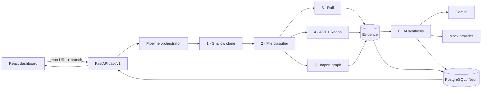

# 🔍 AI Code Review + Repository Analyst

An automated code-review engine that shallow-clones a public GitHub repository into a sandbox, runs **deterministic static analysis** on its Python code (Ruff, Python `ast`, Radon), extracts an **import dependency graph**, and asks an LLM (Google Gemini, or an offline mock) to write a review that is **grounded only in the findings the analyzers produced**. A React dashboard shows findings, a dependency graph, scan history, and AI-suggested fixes.

> **Design idea:** asking an LLM to "review my code" directly invites vague or hallucinated feedback. Here, analyzers produce hard evidence first (file, line, rule, complexity score) and the LLM only summarises and prioritises it.

---

## 📑 Contents

[Features](#-features) · [Architecture](#-architecture) · [Tech Stack](#-tech-stack) · [Project Structure](#-project-structure) · [Getting Started](#-getting-started) · [Configuration](#%EF%B8%8F-configuration) · [API Reference](#-api-reference) · [Data Model](#-data-model) · [How the Analysis Works](#-how-the-analysis-works) · [Safety Limits](#-sandbox--safety-limits) · [Project Status](#-project-status) · [Roadmap](#-roadmap) · [Author](#-author)

---

## ✨ Features

| Feature | Details |
|---|---|
| **Shallow-clone ingestion** | `git clone --depth 1 --single-branch` into a temp folder with a clone timeout and a total repo-size cap; folder is deleted after the run. |
| **Ruff static analysis** | Runs `ruff check` with JSON output; every result is normalised (file, line, column, rule code, message) and mapped to a severity (`CRITICAL` → `INFO`). |
| **AST scanner** | Walks the syntax tree to flag bare `except:` clauses and dynamic code execution (`eval` / `exec`). |
| **Cyclomatic complexity** | Radon scores each function/method; anything above 10 is reported (above 15 = HIGH). Also gives function/class counts and average complexity. |
| **Dependency graph** | Extracts `import` / `from … import` edges per module and renders them as an interactive graph (React Flow). |
| **AI review synthesis** | Gemini turns the top findings and metrics into a structured review. A deterministic **mock provider** is used when no API key is set, so the project runs fully offline. |
| **AI-suggested fixes** | Click a finding to get an explanation and a suggested patch (Gemini, with an offline fallback). |
| **Scan history** | A drawer lists previous scans; open one to reload its report. |
| **Async persistence** | Jobs, findings and dependency edges are modelled in PostgreSQL via SQLAlchemy 2.0 + asyncpg. |
| **Health probes** | `/health` (liveness) and `/health/ready` (checks the database). |

---

## 🏗 Architecture



**Pipeline stages** (tracked on each job as `current_stage`):
`CLONING → INSPECTING_FILES → STATIC_ANALYSIS → AST_ANALYSIS → DEPENDENCY_ANALYSIS → AI_SYNTHESIS → COMPLETED` (or `FAILED` with an error message).

---

## 🧰 Tech Stack

| Layer | Technology |
|---|---|
| Backend | Python, FastAPI, Uvicorn, Pydantic v2, pydantic-settings |
| Database | PostgreSQL (Neon), SQLAlchemy 2.0 (async), asyncpg |
| Analysis | Ruff, Radon, Python `ast` |
| AI | Google Gemini via `google-genai` (`gemini-1.5-flash` by default) · offline mock provider |
| Frontend | React 19, Vite, Tailwind CSS 4, React Flow (`@xyflow/react`), lucide-react |

---

## 📁 Project Structure

```
AI-code-review/
├── app/
│   ├── main.py                    # FastAPI app, CORS, lifespan (creates tables)
│   ├── core/config.py             # Settings loaded from .env
│   ├── api/v1/routes/
│   │   ├── analyses.py            # /analyses endpoints (+ /fix)
│   │   └── health.py              # /health, /health/ready
│   ├── services/
│   │   ├── orchestrator.py        # Runs the 6-stage pipeline
│   │   ├── repository_ingestion.py# Sandboxed shallow clone + size limit + cleanup
│   │   ├── file_classifier.py     # Finds .py files, skips junk/huge files
│   │   ├── static_analysis.py     # Ruff runner + severity mapping
│   │   ├── python_ast_analyzer.py # AST rules + Radon complexity
│   │   ├── dependency_analyzer.py # Import-edge extraction
│   │   └── fixer.py               # AI fix suggestions
│   ├── ai/                        # Provider abstraction: base, gemini, mock, prompts
│   ├── models/                    # AnalysisJob, StaticAnalysisFinding, DependencyEdge
│   ├── schemas/                   # Pydantic schemas
│   └── db/                        # Async engine/session, declarative base
├── frontend/                      # Vite + React dashboard
│   └── src/ (App.jsx, DependencyGraph.jsx)
├── storage/temp_repos/            # Temporary clones (git-ignored)
├── .env.example
├── requirements.txt
└── README.md
```

---

## 🚀 Getting Started

### Prerequisites
- Python 3.10+ and **Git** on your `PATH`
- Node.js 18+ (for the frontend)
- A PostgreSQL database — a free [Neon](https://neon.tech) project works
- *(Optional)* a [Google AI Studio](https://aistudio.google.com/) API key for Gemini

### 1 · Backend

```bash
git clone https://github.com/ShashankSingh2020/AI-code-review.git
cd AI-code-review

python -m venv venv
source venv/bin/activate          # Windows: venv\Scripts\activate
pip install -r requirements.txt

cp .env.example .env              # then fill in DATABASE_URL (see Configuration)
uvicorn app.main:app --reload
```

- API: http://127.0.0.1:8000 · Swagger UI: http://127.0.0.1:8000/docs
- Tables are created automatically on startup.

### 2 · Frontend

```bash
cd frontend
npm install
npm run dev
```

Open the URL Vite prints (usually http://localhost:5173). The dashboard talks to the API at `http://127.0.0.1:8000/api/v1` (set in `frontend/src/App.jsx`).

---

## ⚙️ Configuration

Copy `.env.example` to `.env`. **Never commit `.env`** — it is already in `.gitignore`.

| Variable | Default | Description |
|---|---|---|
| `DATABASE_URL` | *(required)* | `postgresql+asyncpg://<user>:<password>@<host>/<db>?ssl=require` |
| `APP_ENV` | `development` | Environment name (shown by `/health`). |
| `APP_DEBUG` | `true` | Enables SQL echo logging. Use `false` in production. |
| `API_V1_STR` | `/api/v1` | API prefix. |
| `PROJECT_NAME` | `AI Code Review + GitHub Repository Analyst` | Title in the docs. |
| `MAX_REPO_SIZE_MB` | `50` | Reject repos larger than this after cloning. |
| `MAX_REPO_FILES` | `500` | Max files considered during classification. |
| `MAX_SINGLE_FILE_BYTES` | `512000` | Files larger than this are skipped. |
| `CLONE_TIMEOUT_SECONDS` | `45` | Abort the clone after this long. |
| `PIPELINE_TIMEOUT_SECONDS` | `300` | Reserved for an overall pipeline timeout. |
| `TEMP_STORAGE_PATH` | `./storage/temp_repos` | Where clones are stored temporarily. |
| `LLM_PROVIDER` | `mock` | `mock` (offline) or `gemini`. |
| `GEMINI_API_KEY` | – | Needed only for `gemini`. Without it the mock provider is used. |
| `GEMINI_MODEL` | `gemini-1.5-flash` | Gemini model name. |

---

## 📡 API Reference

Base URL: `http://127.0.0.1:8000/api/v1` (interactive docs at `/docs`).

| Method | Endpoint | Description |
|---|---|---|
| `GET` | `/health` | Liveness check. |
| `GET` | `/health/ready` | Readiness check (runs `SELECT 1` against the database). |
| `GET` | `/analyses` | List scan history. |
| `GET` | `/analyses/{job_id}` | Full report for one scan. |
| `POST` | `/analyses` | Start an analysis. Body: `{"repo_url": "...", "branch_name": "main"}` |
| `POST` | `/analyses/fix` | Get an AI explanation and patch for one finding. |

**Start an analysis**
```bash
curl -X POST http://127.0.0.1:8000/api/v1/analyses \
  -H "Content-Type: application/json" \
  -d '{"repo_url": "https://github.com/octocat/Hello-World.git", "branch_name": "main"}'
```

**Report shape**
```json
{
  "job_id": "job_101",
  "repo_url": "https://github.com/octocat/Hello-World.git",
  "branch_name": "main",
  "status": "COMPLETED",
  "structural_metrics": { "file_count": 14, "function_count": 82 },
  "findings": [
    { "rule_id": "E722", "severity": "HIGH", "file_path": "core/processor.py",
      "line": 42, "title": "Do not use bare except", "message": "..." }
  ],
  "dependencies": [
    { "source_node": "core.processor", "target_node": "typing.Optional",
      "edge_type": "import", "line_number": 2 }
  ],
  "ai_summary": "…",
  "created_at": "2026-10-19T01:00:00Z"
}
```

**Request a fix**
```bash
curl -X POST http://127.0.0.1:8000/api/v1/analyses/fix \
  -H "Content-Type: application/json" \
  -d '{"rule_id":"E722","message":"Do not use bare except","file_path":"core/processor.py","line":42,"code_context":"try:\n    ...\nexcept:\n    pass"}'
# → {"explanation": "...", "suggested_patch": "..."}
```

---

## 🗄 Data Model

| Table | Purpose | Key columns |
|---|---|---|
| `analysis_jobs` | One row per scan | `id`, `repo_url`, `repo_name`, `status` (`PENDING/RUNNING/COMPLETED/FAILED`), `current_stage`, `metrics_summary` (JSON), `error_message`, `completed_at` |
| `static_analysis_findings` | Issues found | `job_id` → job, `file_path`, `line`, `rule_id`, `analyzer` (`ruff/ast/radon`), `severity`, `title`, `message` |
| `dependency_edges` | Import graph | `job_id` → job, `source_node`, `target_node`, `edge_type`, `line_number` |

Findings and edges are deleted automatically when their job is deleted (`ON DELETE CASCADE`).

---

## 🔬 How the Analysis Works

- **Ruff** – fast, deterministic lint; codes starting with `S`/`F` map to HIGH, `E`/`W`/`B`/`C90` to MEDIUM, others to LOW.
- **AST scanner** – inspects the parsed tree (not raw text), so comments and strings never cause false positives. Flags `except:` (HIGH) and `eval`/`exec` (CRITICAL).
- **Radon** – cyclomatic complexity per function; >10 is MEDIUM, >15 is HIGH.
- **Dependency extraction** – records every `import` and `from … import` as an edge between module names.
- **Evidence-grounded AI** – only the metrics and the top 15 high/medium findings are sent to the LLM, with instructions not to invent issues. If Gemini isn't configured, a rule-based mock reviewer writes the summary.

---

## 🛡 Sandbox & Safety Limits

- Cloned code is **only parsed, never executed or imported**.
- Shallow, single-branch clone with a timeout and a repo-size cap.
- Files above `MAX_SINGLE_FILE_BYTES`, binary/media files, and folders such as `.git`, `node_modules`, `venv` are skipped.
- Temporary clones are deleted after every run (success or failure).
- All secrets are read from environment variables; `.env` is git-ignored.

---

## 📌 Project Status

- ✅ **Implemented and modular:** ingestion, file classification, Ruff, AST/Radon, dependency extraction, AI provider layer (Gemini + mock), DB models, health checks, React dashboard.
- 🚧 **In progress:** the `/analyses` REST endpoints currently return **sample demo data** while the dashboard is built; connecting them to the real pipeline orchestrator (create a job → run in the background → persist → serve) is the next milestone.
- 🚧 `branch_name` is accepted by the API but the clone does not yet check out a specific branch.

> Remove this section once the endpoints are wired to the orchestrator.

---

## 🗺 Roadmap

- [ ] Wire `/analyses` to `PipelineOrchestrator` with FastAPI background tasks and DB-backed history
- [ ] Honour `branch_name` and validate repository URLs (GitHub HTTPS only)
- [ ] Enable security rules in Ruff (e.g. Bandit `S` rules) explicitly
- [ ] Resolve internal vs. third-party imports in the dependency graph; detect circular imports
- [ ] Tests (pytest + coverage) and GitHub Actions CI
- [ ] Docker / docker-compose and a live deployment
- [ ] Restrict CORS and make the frontend API URL configurable via env
- [ ] Support JavaScript/TypeScript analysis

---

## 👤 Author

**Shashank Pratap Singh** — [GitHub](https://github.com/ShashankSingh2020) · [LinkedIn](https://linkedin.com/in/shashank-pratap-singh-530437303) · singh2020shashank@gmail.com
